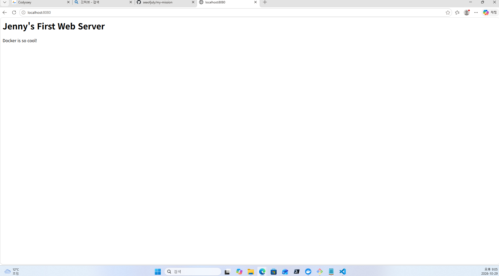
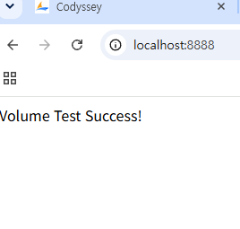
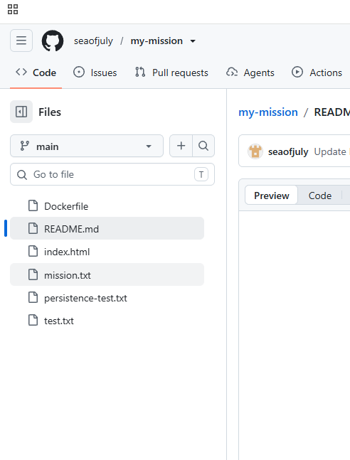

# 🚀 개발 워크스테이션 구축 미션 결과 보고서

## 1. 프로젝트 개요
터미널 환경 설정, Docker 컨테이너 관리, Git/GitHub 버전 관리를 통해 재현 가능한 개발 환경을 구축하고 문서화하는 것을 목표로 합니다.

## 2. 프로젝트 구조 (Directory Tree)
```bash
my-mission/
├── Dockerfile          # Docker 이미지를 빌드하기 위한 설계도
├── index.html          # Nginx 웹 서버에서 보여줄 메인 페이지
├── README.md           # 프로젝트 실습 과정 및 개념 정리 보고서
├── web_result.png      # 웹 서버 접속 성공 화면 캡처
├── git_result.png      # Git 실습 결과 캡처
└── vol_result.png      # 볼륨 마운트 확인 결과 캡처
```
구성 기준: 프로젝트 루트(my-mission)를 중심으로 실행 파일(Dockerfile, HTML)과 증빙 자료(이미지)를 배치하여 관리 효율성을 높였습니다.


## 3. 실행 환경
- **OS:** Windows 11 
- **Shell/Terminal:** Git Bash
- **Docker Version:** Docker version 29.9.2, build a82e528
- **Git Version:** git version 2.56.0.windows.4

## 4. 수행 항목 체크리스트
- [x] 터미널 조작 및 권한 설정 실습
- [x] Docker 설치 및 기본 점검 (version, info)
- [x] Docker 기본 운영 명령 수행 (images, ps, logs, stats)
- [x] 컨테이너 실행 실습 (hello-world, ubuntu)
- [x] Dockerfile 기반 커스텀 이미지 제작 (Nginx)
- [x] 포트 매핑 및 브라우저 접속 확인
- [x] Docker 볼륨을 이용한 데이터 영속성 검증
- [x] Git 사용자 설정 및 GitHub 저장소 연동

---

## 5. 터미널 조작 및 권한 실습 로그

### 5.1 기본 명령어 수행
```bash

# 현재 위치 확인
$ pwd
/c/Users/User/my-mission

# 목록 확인 (숨김 파일 포함)
$ ls -al
total 4
drwxr-xr-x 1 User 197121 0 Oct 31 10:45 .
drwxr-xr-x 1 User 197121 0 Oct 31 10:40 ..
-rw-r--r-- 1 User 197121 50 Oct 31 10:42 README.md

# 디렉토리 생성 및 이동
$ mkdir test_dir
$ cd test_dir

# 빈 파일 생성 및 내용 확인
$ echo "Hello Terminal" > mission.txt
$ cat mission.txt
Hello Terminal

# 복사, 이름 변경, 삭제
$ cp mission.txt mission_copy.txt
$ mv mission_copy.txt renamed_mission.txt
$ rm renamed_mission.txt
```

### 5.2 권한 실습 (chmod) 및 숫자 표기법 설명
```bash
$ chmod 755 mission.txt
```
rwx 비트와 숫자 표기법:
리눅스 권한은 읽기(4), 쓰기(2), 실행(1)의 합으로 계산합니다.
755의 의미: 소유자는 7(4+2+1, 모든 권한), 그룹과 기타 사용자는 5(4+1, 읽기 및 실행 권한)를 가짐을 의미합니다. 

```bash
# 파일 권한 변경 전
$ ls -l mission.txt
-rw-r--r-- 1 User 197121 15 Oct 31 10:46 mission.txt

# 권한 변경 실행
$ chmod 755 mission.txt

# 파일 권한 변경 후 (x가 추가된 것을 확인)
$ ls -l mission.txt
-rwxr-xr-x 1 User 197121 15 Oct 31 10:46 mission.txt

# 디렉토리 권한 변경 전
$ ls -ld test_dir
drwxr-xr-x 1 User 197121 0 Oct 31 10:45 test_dir

# 디렉토리 권한 변경 실행 (소유자만 읽고 쓰기 가능)
$ chmod 700 test_dir

# 디렉토리 권한 변경 후 (drwx------ 확인)
$ ls -ld test_dir
drwx------ 1 User 197121 0 Oct 31 10:45 test_dir
```
---

## 6. Docker 실습 결과

### 6.1 Docker 설치 및 실행 확인
터미널에서 `docker version` 명령어를 통해 클라이언트와 서버 엔진이 정상 작동함을 확인하였습니다.

```bash
$ docker version
Client:
 Version:           29.9.2
 API version:       1.56
 Go version:        go1.26.10
 Git commit:        a82e528
 OS/Arch:           windows/amd64

Server: Docker Desktop 4.97.0 (244584)
 Engine:
  Version:          29.9.2
  API version:      1.56 (minimum version 1.40)
  OS/Arch:          linux/amd64     
```
**Docker 시스템 정보 확인 (docker info):**
```bash
$ docker info
# 전체 내용 중 상단 일부만 기록
Kernel Version: 5.15.153.1-microsoft-standard-WSL2
Operating System: Docker Desktop
OSType: linux
Architecture: x86_64
CPUs: 12
Total Memory: 7.633GiB
```
터미널에서 `docker version` 명령어를 통해 클라이언트와 서버 엔진이 정상 작동함을 확인하였습니다.
(중략: docker version 및 info 로그 내용)

### 6.2 Docker 네트워크 개념
- **네트워크 네임스페이스(Network Namespace):** 컨테이너마다 독립된 네트워크 환경을 부여하여 격리하는 기술입니다.
- **포트포워딩(Port Forwarding):** `-p 8080:80`과 같이 호스트의 포트와 컨테이너 포트를 연결하여 외부 접속을 가능하게 합니다.

### 6.3 포트 충돌 해결 절차 (PID 확인 및 종료)
실습 중 포트 충돌이 발생할 경우 다음 절차로 해결합니다.
1. **PID 확인:** `netstat -ano | findstr :8080` (Windows) 또는 `lsof -i :8080` (Linux) 명령으로 점유 중인 프로세스 ID를 확인합니다.
2. **프로세스 종료:** `kill -9 [PID]` 명령을 통해 해당 프로세스를 강제 종료한 후 다시 실행합니다.

### 6.4 기본 운영 명령

1 **이미지 목록 확인 (`docker images`)**
```bash
IMAGE                  ID             DISK USAGE   CONTENT SIZE   EXTRA
hello-world:latest     c567b231f656       25.9kB         9.49kB    U   
my-web-server:latest   da33294fd7a8        241MB         63.9MB        
nginx:latest           600f7cd45e27        243MB         66.8MB    U   
```

2 **컨테이너 목록 확인 (docker ps -a)**
```bash
CONTAINER ID   IMAGE         COMMAND                   CREATED          STATUS                      PORTS                  NAMES
0fe926a12ed0   hello-world   "/hello"                  10 minutes ago   Exited (0) 9 minutes ago                           jolly_wilson
feb2ffb8a849   hello-world   "/hello"                  13 minutes ago   Exited (0) 13 minutes ago                          mystifying_cohen
1c2c2f9fd41b   nginx         "/docker-entrypoint.…"   38 hours ago     Exited (255) 22 hours ago   0.0.0.0:8080->80/tcp   web-mission-check
```

3 **컨테이너 로그 확인 (docker logs 0fe9)**
```bash
Share images, automate workflows, and more with a free Docker ID:
 https://hub.docker.com/

For more examples and ideas, visit:
 https://docs.docker.com/get-started/
```
---

4 **리소스 사용량 확인 (docker stats --no-stream)**
```bash
CONTAINER ID   NAME              CPU %     MEM USAGE / LIMIT    MEM %     NET I/O        BLOCK I/O   PIDS
a6da93a2c848   recursing_black   0.00%     1.32MiB / 7.619GiB   0.02%     1.7kB / 126B   0B / 0B     1
```


## 7. 컨테이너 실행 실습

### 7.1 hello-world & ubuntu
- `hello-world` 실행 성공 확인
- `ubuntu` 컨테이너 진입 및 명령 수행:
```bash
$ docker run -it ubuntu bash
# 내부에서 ls, echo 수행 후 exit
```

### 7.2 attach vs exec 차이점 정리
attach: 실행 중인 컨테이너의 표준 입력/출력에 연결합니다. 종료 시 컨테이너가 멈출 수 있습니다.
exec: 실행 중인 컨테이너에 새로운 프로세스를 실행합니다. 테스트나 디버깅 시 안전하게 사용 가능합니다.

### 7.3 나만의 웹 서버 빌드 및 실행 (추가)
Dockerfile 작성 및 이미지 빌드
```bash
# Dockerfile을 이용해 my-web-server 이미지 생성
$ docker build -t my-web-server .
```
포트 포워딩을 이용한 컨테이너 실행
```bash
# 8080 포트로 접속하면 컨테이너의 80 포트로 연결되도록 실행
$ docker run -d -p 8080:80 --name web-mission my-web-server
```
실행 상태 확인 (docker ps)
```bash
CONTAINER ID   IMAGE           COMMAND                   CREATED          STATUS          PORTS                                     NAMES
d555583ae5bc   my-web-server   "/docker-entrypoint.…"   57 seconds ago   Up 57 seconds   0.0.0.0:8080->80/tcp, [::]:8080->80/tcp   web-mission
```


---

## 8. 커스텀 이미지 제작 (Nginx)

- **베이스 이미지:** `nginx:latest`
- **커스텀 포인트:** 기본 `index.html` 파일을 로컬의 커스텀 파일로 교체하여 "Jenny's First Web Server" 메시지 출력.

### 8.1 Dockerfile 커스텀 예시
```dockerfile
FROM nginx:alpine
LABEL org.opencontainers.image.title="my-custom-nginx"
ENV APP_ENV=dev

# 로컬의 site 폴더(또는 파일)를 컨테이너 내부의 경로로 복사합니다.
COPY index.html /usr/share/nginx/html/index.html
```

### 8.2 빌드 및 실행 명령어
```bash
# 이미지 빌드
$ docker build -t my-web-server .

# 컨테이너 실행 (8080 포트 연결)
$ docker run -d -p 8080:80 --name my-container my-web-server
```
### 8.3 접속 검증 결과
- **접속 주소:**  localhost:8080
- **접속 증거:**  브라우저 localhost:8080 접속 시 커스텀 메시지 확인 완료.

[결과 화면 스크린샷]


---

## 9. Docker 포트 매핑 실행 로그 예시

- **목적:** 동일한 이미지를 서로 다른 호스트 포트(8080, 8081)에 연결하여 정상 작동하는지 확인.

```bash
### 1. 이미지 빌드 (버전 1.0 태그 부여)
$ docker build -t my-web-server:1.0 .

### 2. 8080 포트로 첫 번째 컨테이너 실행 및 확인
$ docker run -d -p 8080:80 --name my-web-8080 my-web-server:1.0
$ curl http://localhost:8080
Jenny's First Web Server

### 3. 8081 포트로 두 번째 컨테이너 실행 및 확인
$ docker run -d -p 8081:80 --name my-web-8081 my-web-server:1.0
$ curl http://localhost:8081
Jenny's First Web Server
```

## 10. Docker 데이터 관리 (볼륨 및 마운트)

### 10.1 Docker 볼륨 영속성 검증
1. **볼륨 생성:** `docker volume create my-data`
2. **연결 및 파일 생성:** 컨테이너 내 `/usr/share/nginx/html`에 마운트 후 `index.html` 생성.
3. **삭제 후 재연결:** 컨테이너 삭제 후 새 컨테이너(`vol-test-new`) 연결 시 파일 유지 확인.
```bash
#### 1. 볼륨 생성 확인
$ docker volume create my-data
my-data

#### 2. 볼륨을 연결하여 컨테이너 실행 (nginx 경로에 마운트)
$ docker run -d --name vol-test -v my-data:/usr/share/nginx/html nginx

#### 3. 컨테이너 내부에서 파일 생성 (index.html 수정)
$ docker exec vol-test sh -c "echo 'Volume Persistence Test Success' > /usr/share/nginx/html/index.html"

#### 4. 컨테이너 삭제 후 새 컨테이너로 데이터 유지 확인
$ docker rm -f vol-test
$ docker run --name vol-test-new -v my-data:/usr/share/nginx/html nginx cat /usr/share/nginx/html/index.html
Volume Persistence Test Success
```

```bash
# 검증 로그 (docker volume inspect my-data)
[
    {
        "CreatedAt": "2024-05-22T...", 
        "Driver": "local",
        "Labels": null,
        "Mountpoint": "/var/lib/docker/volumes/my-data/_data",
        "Name": "my-data",
        "Options": null,
        "Scope": "local"
    }
]
```
 

### 10.2 바인드 마운트(Bind Mount) 실습
호스트 PC의 특정 디렉토리를 컨테이너와 직접 연결하여 파일을 수정해 보았습니다.

1. 호스트 폴더 준비: C:\Users\User\codyssey\practice\html 폴더 생성 후 index.html 작성
2. 컨테이너 실행:
```bash
$ docker run -d -p 8081:80 --name bind-test -v C:\Users\User\codyssey\practice\html:/usr/share/nginx/html nginx
```
3. 검증: 호스트에서 index.html 내용을 수정하면 브라우저(localhost:8081)에 즉시 반영됨을 확인하였습니다.

### 10.3 볼륨 백업 및 복원 절차
데이터의 안전한 보관을 위해 볼륨 데이터를 아카이브 파일로 백업하고 복원하는 과정을 수행했습니다.

**1) 백업 (Backup):**
`my-data` 볼륨의 내용을 `backup.tar` 파일로 압축하여 현재 디렉토리에 저장합니다.
```bash
$ docker run --rm -v my-data:/source -v $(pwd):/backup busybox tar cvf /backup/backup.tar /source

**2) 복원 (Restore):
$ docker run --rm -v my-data:/dest -v $(pwd):/backup busybox tar xvf /backup/backup.tar -C /
```

**3) 백업 결과 확인 (Verification):
생성된 backup.tar 파일의 내부 목록을 확인하여 데이터가 정상적으로 포함되었는지 검증합니다.
```bash
$ tar -tvf backup.tar
drwxr-xr-x  0 root   root        0 10 31 12:39 source/
-rw-r--r--  0 root   root      497 10 21 23:24 source/50x.html
-rw-r--r--  0 root   root       21 10 31 12:40 source/index.html
```
검증 완료: source/index.html을 포함한 볼륨 데이터가 성공적으로 아카이브된 것을 확인했습니다.

---

## 11. Git 및 GitHub 연동

### 11.1 Git 설정 확인
```bash
user.name=Jenny
user.email=*******@gmail.com  # 개인정보 보호를 위해 마스킹 처리함
init.defaultbranch=master
remote.origin.url=https://github.com/seaofjuly/docker-practice.git
```

### 11.2 GitHub 연동 증거
- 저장소 URL: [https://github.com/seaofjuly/docker-practice](https://github.com/seaofjuly/docker-practice)
- 

## 12. 트러블슈팅 (Troubleshooting)

### 12.1 VS Code에서 기존 폴더가 열리지 않는 문제
문제: VS Code에서 Path does not exist 오류가 발생하며 작업 폴더가 열리지 않음.
원인: 공용 컴퓨터 환경 특성상 기존에 작업했던 로컬 폴더가 삭제되었거나 경로가 변경됨.
해결: GitHub 저장소(https://github.com/seaofjuly/my-mission)에서 git clone을 통해 프로젝트를 다시 내려받아 작업 환경을 즉시 복구함.

### 12.2 포트 충돌 문제 (Port Conflict)
문제: Nginx 컨테이너 실행 시 Bind for 0.0.0.0:8080 failed: port is already allocated 에러 발생.
원인: 이미 로컬 PC의 8080 포트를 다른 서비스나 이전 컨테이너가 점유하고 있어 충돌이 발생함.
해결: netstat 명령어로 포트 상태를 확인한 후, 컨테이너 실행 시 호스트 포트를 8081로 변경(-p 8081:80)하여 정상적으로 서비스를 실행함.

### 12.3 Docker 권한 문제 (Permission Denied)
문제: 터미널에서 docker 명령어 입력 시 권한 관련 에러 발생하며 명령어가 거부됨.
원인: 현재 사용자 계정에 Docker 실행 권한이 없거나, Docker Desktop 엔진이 활성화되지 않음.
해결: 터미널을 '관리자 권한'으로 실행하고, Docker Desktop의 상태를 확인하여 엔진이 정상 작동 중임을 확인한 후 해결함.

### 12.4 Docker 컨테이너 삭제 후 데이터 유지 문제
문제: 컨테이너를 삭제(docker rm)했을 때 내부에서 수정했던 파일이 함께 사라지는 현상에 대한 의문 발생.
원인: 컨테이너의 기본 파일 시스템은 휘발성(Ephemeral)이므로 삭제 시 데이터가 소멸됨을 파악함.
해결: Docker Volume을 생성하여 호스트와 컨테이너를 연결(Mount)함으로써, 컨테이너를 삭제하고 재생성하더라도 데이터가 영구적으로 유지되는 것을 실습을 통해 검증함.
